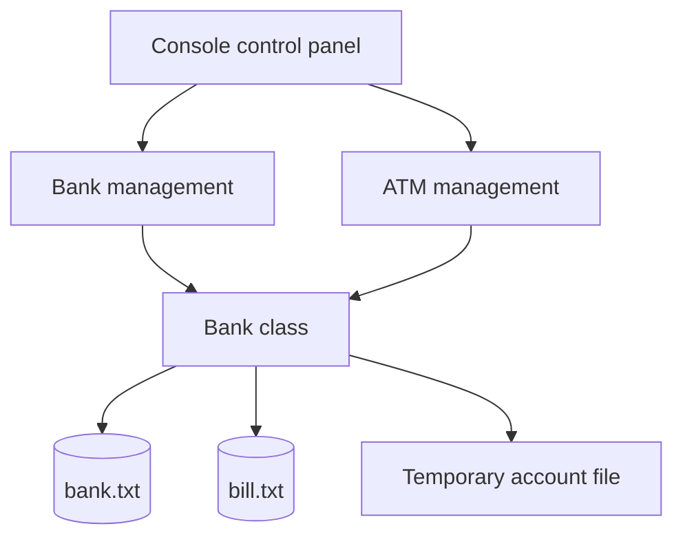

# Bank & ATM Management System


## Overview

A Windows console application that simulates bank administration and ATM operations using C++ and local file persistence. The project explores class-based design, standard library streams, account management and balance updates. It is an educational simulation, not software for real financial transactions.

## Features

| Bank administration | Customer ATM |
|---|---|
| Create, find, edit and delete accounts | Check balance |
| Deposit and withdraw funds | Withdraw funds |
| Transfer between accounts | View account details |
| Bill payment and history | Account credential checks |
| List account records | Return to main menu |

The administration menu exposes 11 operations, while the ATM menu exposes three customer operations.

## Architecture



The Bank class encapsulates account fields and implements menu navigation, persistence and operation logic. Account lookup uses sequential file scans. Updates commonly rewrite records through a temporary file before replacing the account file. Some operations check amounts and available balances.

## Persistence

- bank.txt: account ID, name, family name, address, PIN, password, phone and balance.
- bill.txt: bill payment history, including account ID, bill name, amount and date.
- bank1.txt: temporary account data used during updates.

Records are whitespace-delimited. Lookups and full-file rewrites have O(n) time complexity for n accounts.

## Build and run

Windows with a compatible C++ compiler (such as MinGW-w64) is required because the source uses Windows headers and console functions.

```bash
git clone https://github.com/Claudio1009/Bank-ATM-Management-System.git
cd Bank-ATM-Management-System
g++ bank.cpp -o bank.exe
```

Run bank.exe from the repository directory. Alternatively, the supplied CMakeLists.txt specifies CMake 4.0 and C++26; use a toolchain supporting that configuration.

The program creates data files in its working directory. Use fictional local accounts only. The current administrative credentials are defined in bank.cpp; do not reuse them elsewhere.

## Project structure

| File | Purpose |
|---|---|
| bank.cpp | Bank class, console menus and operations |
| CMakeLists.txt | Build configuration |
| README.md | Documentation |

## Validation and limitations

Suggested manual checks include duplicate account IDs, insufficient funds, deposits, transfers, invalid input and persistence after restarting.

The implementation is single-process and uses plaintext credentials, floating-point balances and non-transactional file replacement. Credentials are also displayed by some operations. Future work should introduce password hashing, fixed-point balances, input validation, transactional storage, separation of UI and business logic, portable console APIs and automated tests.

No successful build or automated test result is claimed.

## Author

Claudiu Marius Ciupitu — [GitHub](https://github.com/Claudio1009)
